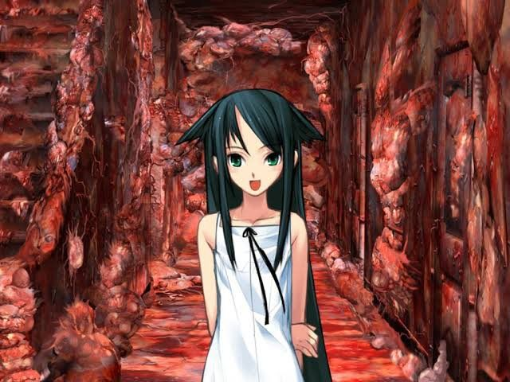

# Saya no uta
### Premisa
Fuminori, un estudiante universitario de medicina, sufre un fatal accidente donde mueren sus padres pero él sobrevive. Al despertar de una operación cerebral para salvar su vida nota que el mundo ha cambiado y ahora todo se ve como una masa aterradora de carne, menos una chica que va a visitarlo al hospital.

### Datos generales
Saya no uta/Visual novel

Desarrollador: Nitroplus

Autor: Gen Urobuchi

Lanzamiento: 2003

> “Perhaps the most fascinating thing about The Song of Saya is that somehow, in the middle of all the horrors it presents, it manages to make the abominable, beautiful.”

<del>**_Una experiencia de horror cósmico, romance y perturbación_**<del>

### Mecánicas
- Click para pasar al siguiente texto
- Tomar decisiones
- Narrativa engañosa
- Colección de diferentes finales
- Encontrar el final verdadero

| Cámara | Ritmo | Interfaz |
| --- | --- | --- |
| Primera persona | Lectura del jugador | Ilustraciones y texto |

[Descarga el juego quí](https://store.steampowered.com/app/702050/The_Song_of_Saya/?l=spanish)